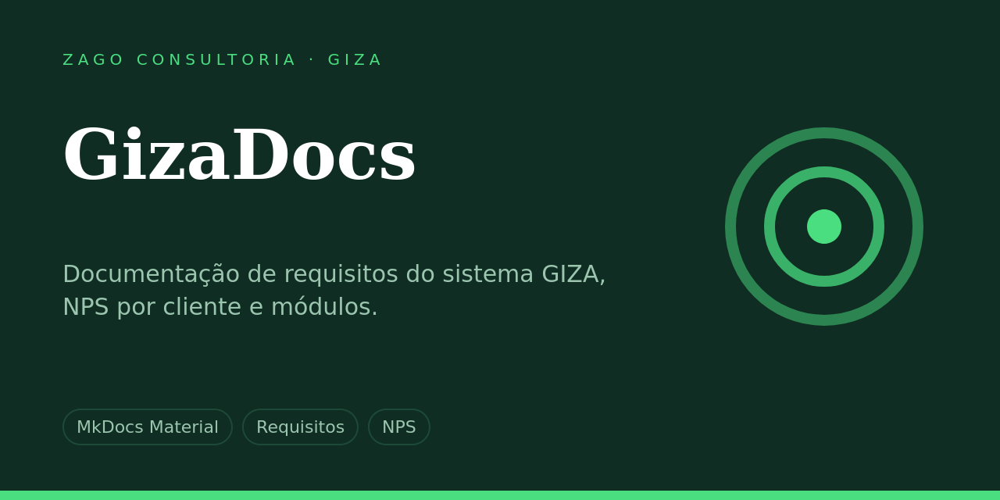

<p align="center">
  
</p>

<p align="center"><b>Documentação de requisitos do sistema GIZA: módulos, histórias de usuário, indicadores e NPS por cliente.</b></p>

<p align="center">
  
  
  
</p>

**Sumário:** [Visão geral](#visão-geral) · [Estrutura](#estrutura) · [Começando](#começando) · [Deploy e operação](#deploy-e-operação) · [Contribuindo](#contribuindo) · [Segurança](#segurança) · [Mantenedores](#mantenedores)

---

## Visão geral

Site de documentação dos requisitos funcionais e não funcionais do GIZA, aplicação de gestão de programas ambientais, com módulos, discovery, histórias de usuário, indicadores e resultados de NPS.

## Estrutura

```
docs/modulos/            módulos e discovery
docs/historias_de_usuario/
docs/indicadores/
docs/NPS/                resultados por cliente
mkdocs.yml, custom.css
```

## Começando

### Rodar localmente

```bash
pip install mkdocs mkdocs-material
mkdocs serve        # http://127.0.0.1:8000
```

## Deploy e operação

O site é publicado pelo GitHub Pages. Com o renome o endereço passa de `zagoconsultoria.github.io/GIZAdocs` para `zagoconsultoria.github.io/GizaDocs`, e o GitHub não redireciona o endereço antigo.

## Contribuindo

1. Crie uma branch a partir de `main`: `feat/…`, `fix/…`, `docs/…` ou `chore/…`.
2. Use mensagens no padrão [Conventional Commits](https://www.conventionalcommits.org/pt-br/v1.0.0/), por exemplo `feat(auth): adiciona recuperação de senha`.
3. Abra um Pull Request e aguarde revisão e CI verde antes de integrar.
4. Nunca versione chaves, tokens, senhas, certificados ou arquivos `.env`.

## Segurança

Vulnerabilidades e vazamentos devem ser comunicados diretamente à equipe de tecnologia, sem abrir issue pública.

## Mantenedores

Equipe de tecnologia da Zago Consultoria.

Repositório da organização [ZagoConsultoria](https://github.com/ZagoConsultoria). Todos os direitos reservados; não há licença de código aberto definida.
